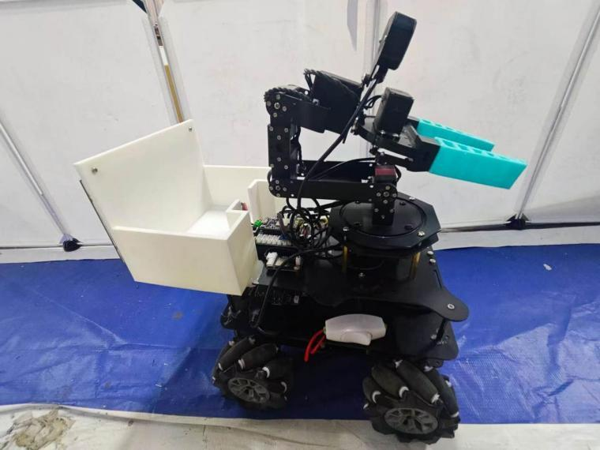
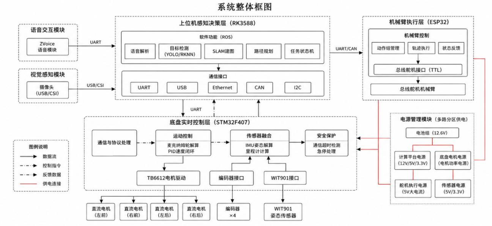
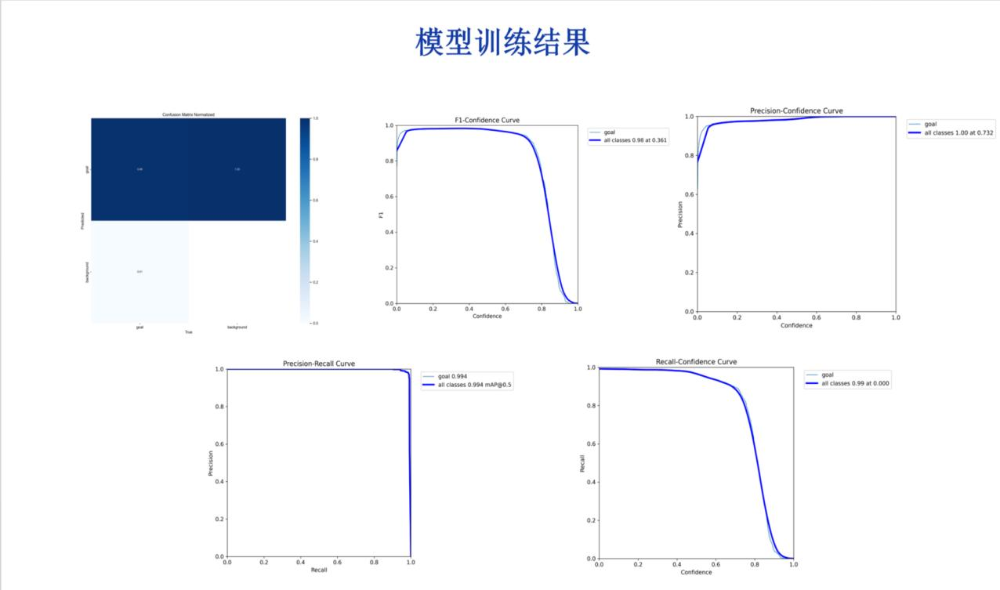

# 基于 RK3588 的智能物料拾取机器人

**ROS 2 · RK3588 · STM32F407 · RKNN · 移动操作**

2026 年全国大学生嵌入式芯片与系统设计竞赛团队项目。机器人面向室内球体拾取与轻量物料递送，将视觉检测、导航、底盘运动和机械臂操作组织为分阶段任务。

[演示视频](./演示视频.mp4) · [技术文档](./技术文档.pdf) · [核心源码](./src/)

## 1. 系统组成

| 平台 | 工作内容 |
|---|---|
| RK3588 | 运行 ROS 2，执行 YOLO / RKNN 视觉推理、导航调度和任务状态机 |
| STM32F407 | 麦克纳姆轮运动控制、编码器反馈、里程计与串口通信 |
| ESP32 | 机械臂动作执行与舵机控制 |
| RGB-D 相机与激光雷达 | 提供目标图像、深度和环境扫描数据 |

```text
RGB-D 相机 / 激光雷达
          │
          ▼
    RK3588 · ROS 2
    ├─ robot_vision：目标检测、深度定位、视觉里程计
    ├─ my_robot_core：任务状态机、Nav2、EKF、底盘接口
    └─ jibot1_driver：机械臂驱动与抓取接口
          │
     ┌────┴─────┐
     ▼          ▼
STM32F407     ESP32
麦轮底盘       机械臂
```

## 2. 个人工作

本项目由团队合作完成。我主导 ROS 2 导航与任务控制、视觉感知、多传感器状态估计以及 STM32F407 底盘控制，参与机械臂控制和整机联调。

### 导航与任务状态机

通过 Nav2 的 `NavigateToPose` Action 接口下发导航目标，将目标搜索、导航接近、视觉对位和抓取拆分为任务状态，并处理超时、目标丢失和障碍物等情况。

代码：[main_control.py](./src/my_robot_core/my_robot_core/main_control.py)

### 目标检测与三维定位

使用 RKNNLite 在 RK3588 上运行 YOLO 模型。对检测候选进行颜色与轮廓筛选，再结合深度图和相机内参估计目标三维位置，为视觉对位提供输入。

代码：[npu_3d_tracker.py](./src/robot_vision/robot_vision/npu_3d_tracker.py)

### 多传感器状态估计

开发二维 EKF 节点，融合轮式里程计与 IMU，并提供可选的 RGB-D 视觉里程计输入。视觉里程计节点通过 RGB-D 特征匹配估计相机运动，作为定位的辅助观测。

代码：[planar_ekf_node.py](./src/my_robot_core/my_robot_core/planar_ekf_node.py) · [rgbd_visual_odometry_node.py](./src/robot_vision/robot_vision/rgbd_visual_odometry_node.py)

### 底盘控制与整机联调

负责麦轮运动学、编码器反馈和底盘速度闭环，连接 RK3588 与 STM32F407 的运动指令及里程计反馈接口；参与机械臂驱动、运动学、抓取接口及多控制器通信调试。

代码：[base_driver.py](./src/my_robot_core/my_robot_core/base_driver.py) · [机械臂功能包](./src/jibot1_driver/)

## 3. 关键代码

| 入口 | 内容 |
|---|---|
| [my_robot_core](./src/my_robot_core/) | 任务控制、导航、状态估计与底盘驱动 |
| [robot_vision](./src/robot_vision/) | RKNN 目标检测、RGB-D 定位与视觉里程计 |
| [jibot1_driver](./src/jibot1_driver/) | 机械臂运动学、驱动和任务接口 |
| [pick_place_node.py](./src/jibot1_driver/jibot1_driver/pick_place_node.py) | 抓取任务执行节点 |

单元测试：[任务状态机](./src/my_robot_core/test/test_main_control.py) · [二维 EKF](./src/my_robot_core/test/test_planar_ekf_node.py) · [RGB-D 里程计](./src/robot_vision/test/test_rgbd_visual_odometry_node.py)

## 4. 项目展示

### 机器人实物



麦克纳姆轮底盘搭载机械臂与传感器，RK3588、STM32F407 和 ESP32 分别承担感知决策、底盘控制与机械臂执行。

### 系统架构



### ROS 地图与导航界面


图源为项目竞赛技术文档，展示 ROS 地图、传感器数据与导航信息。项目不同主控版本的界面资料集中保存在该文档中。

### 目标检测模型训练



训练图包含混淆矩阵、F1-Confidence、Precision-Confidence 和 PR 曲线，用于查看球体检测模型在训练评估阶段的表现。

## 5. 工程入口

| 内容 | 文件 |
|---|---|
| 硬件接入 | [hardware_bringup.launch.py](./src/my_robot_core/launch/hardware_bringup.launch.py) |
| 建图 | [full_slam_bringup.launch.py](./src/my_robot_core/launch/full_slam_bringup.launch.py) |
| 导航 | [full_nav_bringup.launch.py](./src/my_robot_core/launch/full_nav_bringup.launch.py) |
| EKF 配置 | [ekf_planar_params.yaml](./src/my_robot_core/config/ekf_planar_params.yaml) |
| 视觉接入 | [vision_bringup.launch.py](./src/robot_vision/launch/vision_bringup.launch.py) |

运行前需配置底盘串口、雷达与相机设备、相机坐标关系及 RKNN 模型路径；各功能包依赖见对应 `package.xml`。

## 6. 第三方组件

工程使用 ROS 2、Nav2、RKNNLite，以及 `costmap_converter`、`OrbbecSDK_ROS2-master`、`sllidar_ros2`、`teb_local_planner` 和 `vision_opencv` 等组件。个人工作集中在任务逻辑、感知处理、状态估计、底盘控制与系统集成。
