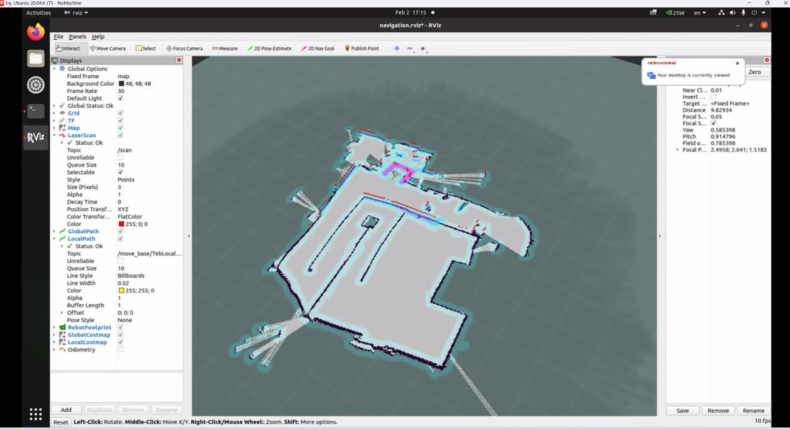

# 基于 RK3588 的智能物料拾取机器人

**RK3588 Mobile Manipulation Robot | ROS 2 · SLAM · Computer Vision · Robotic Manipulation**

> 2026 年全国大学生嵌入式芯片与系统设计竞赛团队项目。

## 🎬 项目演示 | Demo

- [▶ 查看机器人演示视频](./演示视频.mp4)
- [📄 阅读完整技术文档](./技术文档.pdf)

> 演示视频与技术文档为团队作品材料；具体功能的验证范围以实际演示及测试记录为准。

## 1. 项目概览 | Overview

本项目面向室内球体拾取与轻量物料递送任务，构建了一套由 **RK3588 + STM32F407 + ESP32** 协同工作的移动操作机器人系统，涉及视觉目标检测、环境建图与导航、麦克纳姆轮运动控制、机械臂抓取和多阶段任务调度。

| 平台          | 主要职责                                       |
| ------------- | ---------------------------------------------- |
| **RK3588**    | ROS 2 节点、YOLO/RKNN 视觉推理、导航及任务调度 |
| **STM32F407** | 麦克纳姆轮控制、编码器反馈、里程计与串口通信   |
| **ESP32**     | 机械臂动作执行与舵机控制（固件内容待单独整理） |

本项目采用**视觉感知—导航决策—底盘执行—机械臂操作**的分层技术路线，属于传统机器人感知与控制系统，并非端到端 VLA 策略模型。

## 2. 系统架构与核心代码 | Architecture & Code

```text
RGB-D 相机 / 激光雷达 / 任务输入
              │
              ▼
        RK3588 · ROS 2
  ├─ robot_vision：YOLO/RKNN、RGB-D 感知
  ├─ my_robot_core：状态机、Nav2、EKF、底盘接口
  └─ jibot1_driver：机械臂任务接口
              │
       ┌──────┴──────┐
       ▼             ▼
 STM32F407 底盘     机械臂控制侧
  麦轮 / 里程计      抓取动作执行
```

### 核心功能包

| 模块             | 主要功能                                           | 源代码                                |
| ---------------- | -------------------------------------------------- | ------------------------------------- |
| 机器人导航与控制 | 任务状态机、导航调度、二维 EKF、底盘通信           | [my_robot_core](./src/my_robot_core/) |
| 视觉感知         | RKNNLite/YOLO 推理、目标三维定位、RGB-D 视觉里程计 | [robot_vision](./src/robot_vision/)   |
| 机械臂控制       | 运动学、驱动与抓取执行                             | [jibot1_driver](./src/jibot1_driver/) |

### 关键代码入口

| 文件                                                         | 代码中的主要实现                                             |
| ------------------------------------------------------------ | ------------------------------------------------------------ |
| [main_control.py](./src/my_robot_core/my_robot_core/main_control.py) | ROS 2 任务状态机、Nav2 `NavigateToPose` 接口、视觉对位与抓取流程 |
| [npu_3d_tracker.py](./src/robot_vision/robot_vision/npu_3d_tracker.py) | RKNNLite 推理、YOLO 后处理、颜色/形状筛选、深度目标定位      |
| [planar_ekf_node.py](./src/my_robot_core/my_robot_core/planar_ekf_node.py) | 轮式里程计、IMU 与可选 RGB-D 里程计的二维 EKF 融合           |
| [rgbd_visual_odometry_node.py](./src/robot_vision/robot_vision/rgbd_visual_odometry_node.py) | RGB-D 特征匹配和视觉位姿估计                                 |
| [base_driver.py](./src/my_robot_core/my_robot_core/base_driver.py) | 底盘串口接口、运动指令与里程计/IMU 话题发布                  |
| [pick_place_node.py](./src/jibot1_driver/jibot1_driver/pick_place_node.py) | 机械臂抓取任务执行节点                                       |

**单元测试入口：** [任务状态机测试](./src/my_robot_core/test/test_main_control.py) · [EKF 测试](./src/my_robot_core/test/test_planar_ekf_node.py) · [RGB-D 里程计测试](./src/robot_vision/test/test_rgbd_visual_odometry_node.py)

## 3. 个人贡献 | My Contributions

本项目由团队合作完成。**本人主导** ROS 2 导航与任务控制、机器人视觉感知、多传感器状态估计以及 STM32F407 底盘控制；**参与** 机械臂控制和整机系统架构与联调。

### 主导开发 | Primary Contributions

**① ROS 2 导航与任务状态机**

- 基于 Nav2 `NavigateToPose` Action 接口实现导航目标调度。
- 设计目标搜索、导航接近、视觉对位、抓取等任务状态，以及超时、目标丢失和障碍物相关处理逻辑。
- 对应代码：[main_control.py](./src/my_robot_core/my_robot_core/main_control.py)。

**② 视觉感知与 RKNN 端侧推理**

- 在 RK3588 上使用 RKNNLite 运行 YOLO 检测模型，并实现目标检测后处理。
- 结合颜色、轮廓形状及深度信息完成候选目标筛选和三维位置估计。
- 对应代码：[npu_3d_tracker.py](./src/robot_vision/robot_vision/npu_3d_tracker.py)。

**③ 多传感器状态估计**

- 开发二维 EKF 节点，实现轮式里程计、IMU 和可选 RGB-D 视觉里程计的状态融合。
- 开发 RGB-D 特征匹配与视觉位姿估计节点，为导航定位提供辅助观测。
- 对应代码：[planar_ekf_node.py](./src/my_robot_core/my_robot_core/planar_ekf_node.py)、[rgbd_visual_odometry_node.py](./src/robot_vision/robot_vision/rgbd_visual_odometry_node.py)。

**④ STM32F407 麦克纳姆轮底盘控制**

- 主导底盘控制模块开发，涉及麦轮运动学、编码器反馈和速度闭环控制。
- 对接 RK3588 与 STM32F407 的通信链路，实现运动指令和里程计反馈交互。
- ROS 接口：[base_driver.py](./src/my_robot_core/my_robot_core/base_driver.py)；底盘 MCU 固件待独立整理并补充链接。

### 协同开发 | Collaborative Contributions

- **机械臂：** 参与机械臂驱动、运动学及抓取接口的开发与联调。
- **整机系统：** 参与多控制器通信、ROS 2 节点集成以及导航、感知、执行链路的实机调试。

> 本节描述本人在团队项目中的实际分工；Nav2、ROS 2、相机驱动及其他第三方组件不作为本人独立原创算法成果。


## 4. 项目实验与结果 | Experiments & Results

本项目围绕移动机器人的视觉感知、环境建图、
自主导航与机械臂操作开展系统开发和实验验证。

以下展示项目开发过程中保存的机器人实物、
系统架构、ROS 可视化及视觉模型训练资料。

### 4.1 机器人实物 | Robot Prototype


**图 1. 移动操作机器人实物**

机器人采用麦克纳姆轮移动底盘与机械臂组合，
通过 RK3588、STM32F407 和 ESP32
实现感知决策、底盘控制和机械臂执行的分层协同。

### 4.2 系统架构 | System Architecture


**图 2. RK3588 机器人系统架构**

系统主要分为三个部分：

- **感知与决策层：** RK3588 运行 ROS 2，
  负责视觉推理、地图构建、导航规划及任务调度。
- **运动控制层：** STM32F407 负责麦克纳姆轮
  运动学、编码器反馈和底盘速度控制。
- **执行控制层：** ESP32 负责机械臂动作组
  和抓取执行接口。

### 4.3 SLAM 建图与可视化 | SLAM Visualization



**图 3. 项目 ROS 建图与导航可视化界面**

项目使用 ROS 框架组织机器人导航与感知模块，
通过 RViz 可视化地图、传感器数据和导航相关信息。

该图取自项目相关竞赛技术文档，
展示了 ROS 环境下的地图与导航可视化结果。

注：项目存在不同边缘计算主控的开发版本，
本截图不单独作为 RK3588 版本完整自主导航
已通过实机验收的证明。

### 4.4 视觉模型训练 | Visual Perception


**图 4. 目标检测模型训练与评估曲线**

项目采用 YOLO 目标检测方法进行球体目标感知，
并针对机器人实际使用场景开展视觉模型实验。

图中展示了训练阶段保存的评估结果，
包括混淆矩阵、F1-Confidence、
Precision-Confidence 和 PR 曲线等。

模型训练评估与端侧部署性能分别统计。
RK3588 上的 RKNN 推理延迟、检测精度和
实际运行帧率，需要使用对应版本的实测结果说明。

### 4.5 实验状态与后续完善 | Verification Status

| 实验内容 | 当前展示材料 |
|---|---|
| 机器人硬件平台 | 整机实物照片 |
| 系统总体设计 | RK3588 系统架构图 |
| ROS 地图与导航可视化 | RViz 截图 |
| 视觉模型训练 | 训练评估曲线 |
| EKF 融合性能 | 待补充对比测试数据 |
| RKNN 端侧推理性能 | 待补充实测结果 |
| 完整自主抓取成功率 | 待补充定量统计 |

> **说明：** 本项目为团队合作成果。
> 图片与技术资料来自项目开发及相关竞赛报告。
> 部分截图对应不同硬件版本，具体实验平台
> 与完整功能验收情况以各版本实测记录为准。


## 5. 环境与运行 | Setup & Usage

仓库包含 ROS 2 Python 功能包及硬件相关配置，完整依赖版本、设备映射、相机外参和可复现启动流程仍在核对。

## 6. 第三方依赖与致谢 | Third-Party Software

工程中涉及 `costmap_converter`、`OrbbecSDK_ROS2-master`、`sllidar_ros2`、`teb_local_planner` 和 `vision_opencv` 等第三方组件。这些代码不是团队独立原创成果；

感谢项目团队成员在机械结构、电子系统、代码开发与集成验证中的合作。

---

*Repository status: Documentation and reproducibility materials are being organized.*
